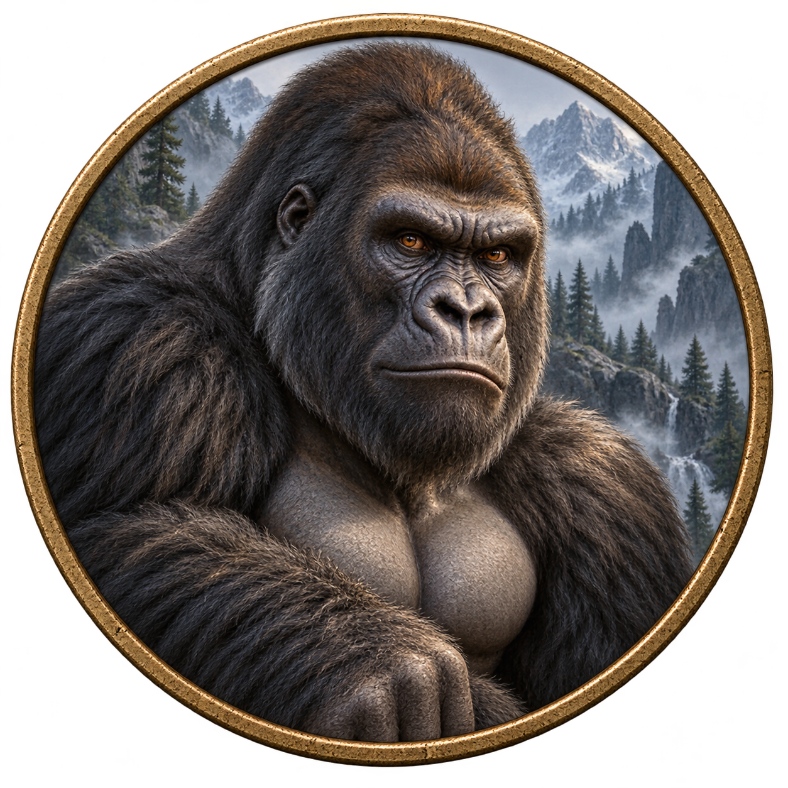
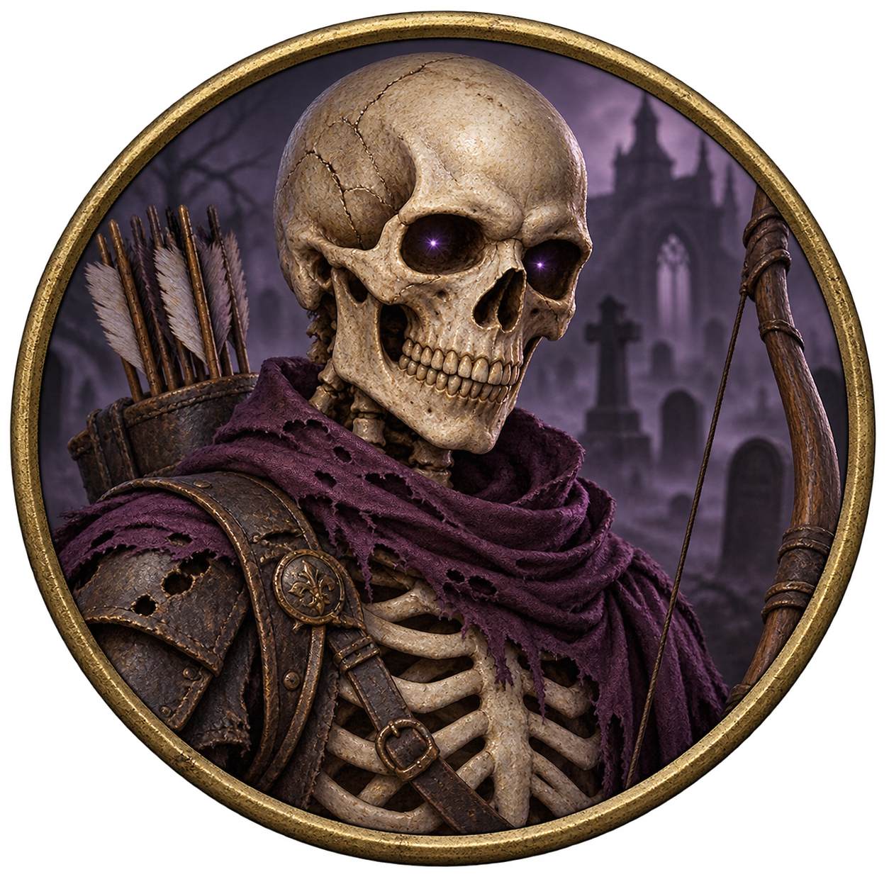
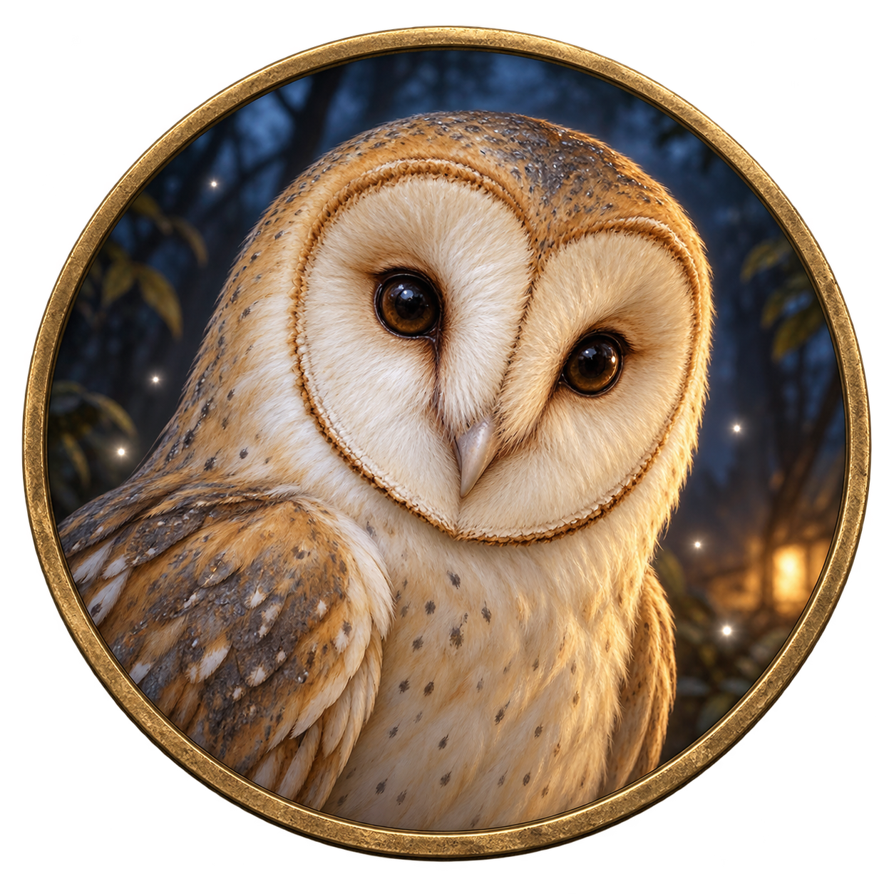
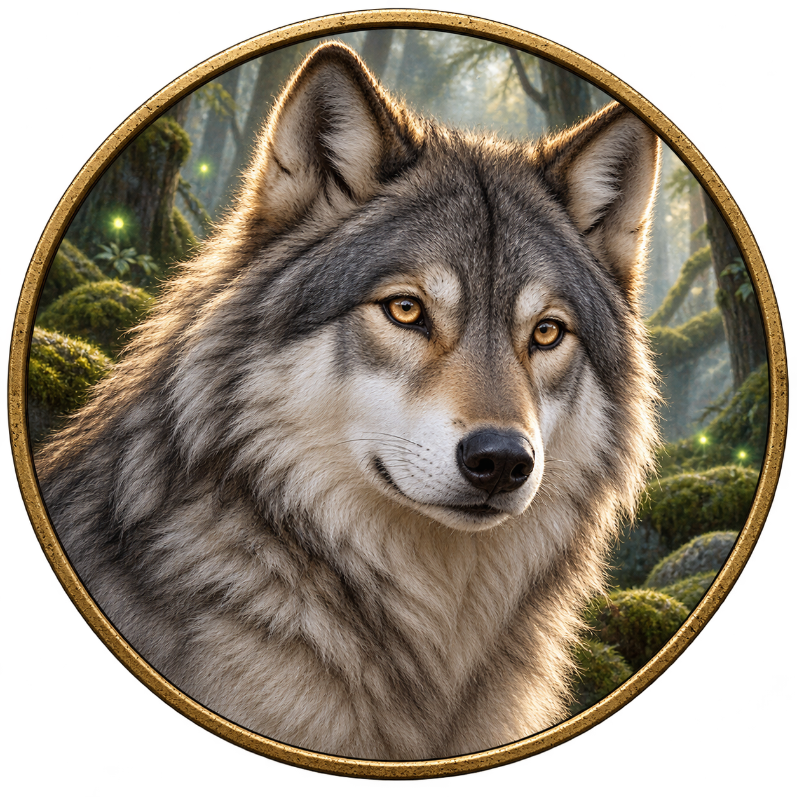
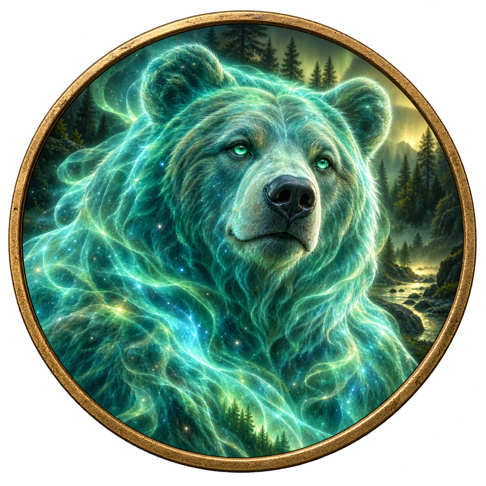
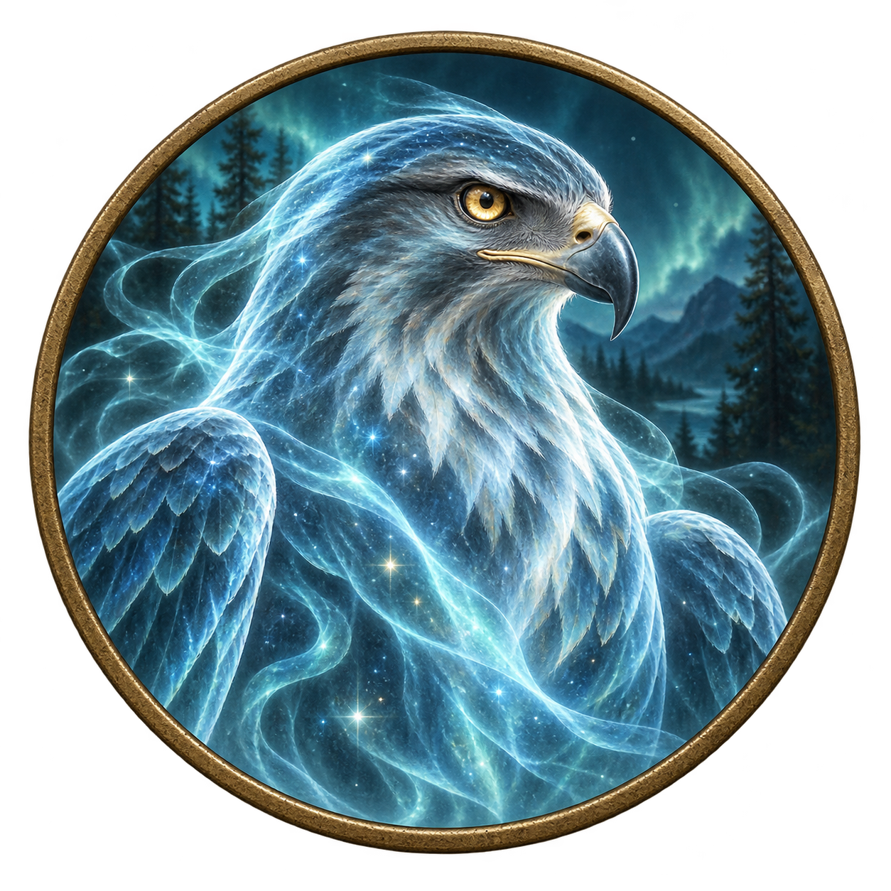
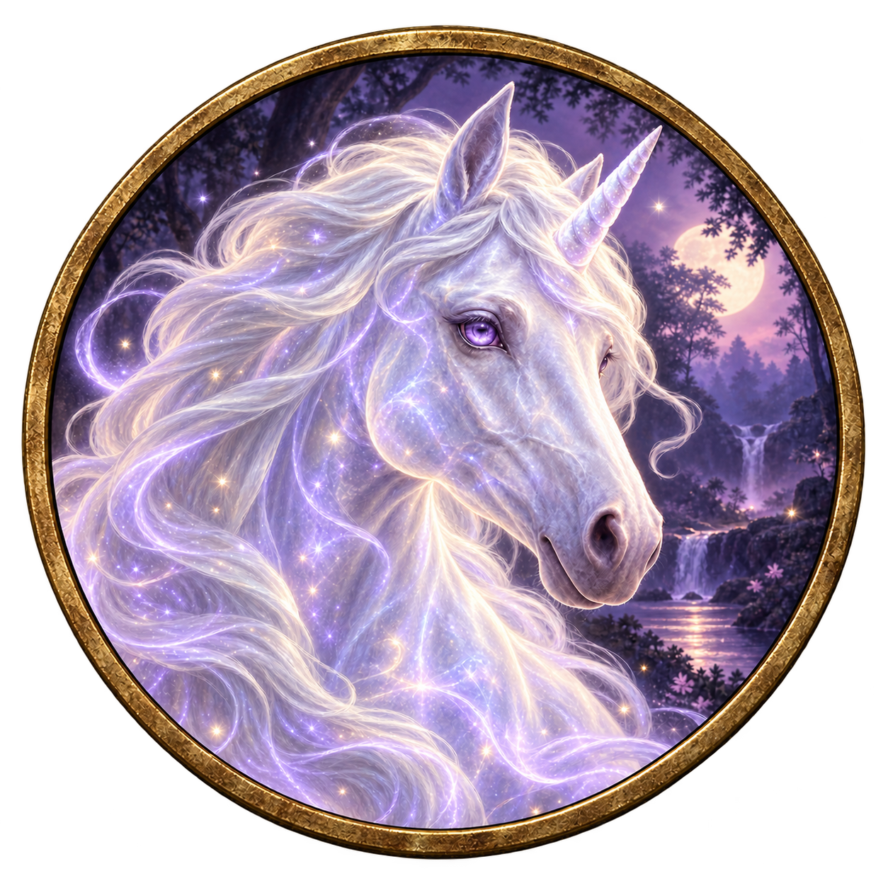

# Companion and spirit tokens

[Download the 7 companion PNGs](../roll20-companion-tokens.zip) · [Full gallery and all 18 tokens](README.md)

These match the PCs' circular antique-brass tokens, with transparent backgrounds outside the borders. Extract the ZIP and upload the individual PNGs to Roll20's **Art Library → My Library**.

| Token | Use | Size on a 5-foot grid |
| --- | --- | --- |
| [Giant ape](companion-giant-ape-torren.png) | Torren's Call of the Beast Lord | **3 × 3 squares**, Huge |
| [Skeleton archer](companion-skeleton-isolde.png) | Isolde's Animate Dead servant; reuse for each actual skeleton | **1 × 1 square**, Medium |
| [Owl](companion-owl-familiar.png) | Optional familiar form for Lio, Mira or Bryn | Tiny; use a small icon within a square, or one square for visibility |
| [Wolf](companion-wolf-bryn.png) | Example Conjure Animals option for Bryn, subject to GM creature selection | **1 × 1 square**, Medium |
| [Bear Spirit](spirit-bear-bryn.png) | Bryn's Spirit Totem effect marker | One-square visual marker; **30-foot-radius aura** |
| [Hawk Spirit](spirit-hawk-bryn.png) | Bryn's Spirit Totem effect marker | One-square visual marker; **30-foot-radius aura** |
| [Unicorn Spirit](spirit-unicorn-bryn.png) | Bryn's Spirit Totem effect marker | One-square visual marker; **30-foot-radius aura** |

## Gallery

| Giant ape | Skeleton archer | Owl familiar |
| --- | --- | --- |
|  |  |  |

| Wolf | Bear Spirit | Hawk Spirit |
| --- | --- | --- |
|  |  |  |

| Unicorn Spirit |
| --- |
|  |

## Set up in Roll20

1. Drag a PNG from your Art Library onto **Objects & Tokens** and set its size using the table above.
2. For the ape or skeleton, import the existing [Giant Ape JSON](https://github.com/rybr00159/Roll20/blob/main/examples/companions/npc-giant-ape-torren.json) or [Skeleton JSON](https://github.com/rybr00159/Roll20/blob/main/examples/companions/npc-skeleton-isolde.json). Set **Represents Character** to the matching NPC reference, then save the configured token using that character's **Edit → Default Token** control. The owl and wolf artwork does not include a new stat-block import.
3. For several skeletons or wolves, use separate tokens with individual HP. Leave each HP bar unlinked so damage to one creature does not change all copies. Optional names such as `Skeleton 1` and `Skeleton 2` help track them.
4. Use the spirit images as effect markers. Set a token aura to a **30-foot radius**, with player visibility as desired. These spirits are intangible, invulnerable effects, not summoned creatures with their own HP or attacks; the one-square marker is only a visual aid. Bryn has one active Spirit Totem at a time, with its normal duration and use limit.

The ape still requires Torren's maneuver and concentration. Isolde must actually create and maintain control over each skeleton and supply its equipment. The owl is an optional Find Familiar form; Bryn's Wild Companion uses its normal temporary duration. The wolf is an example for a GM-selected Conjure Animals result. Tokens do not grant free starting creatures or change any 2014 rules.

Keep PNG transparency intact when uploading; JPEG or a screenshot adds a rectangular background. Artwork upload and default-token assignment are manual steps in your Roll20 game.
